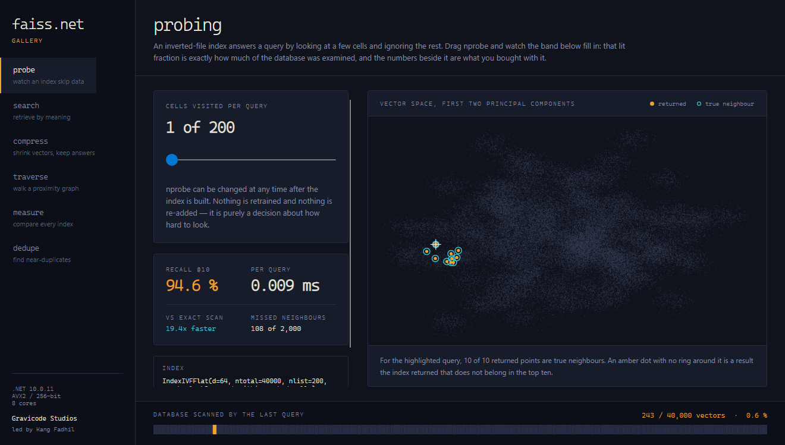
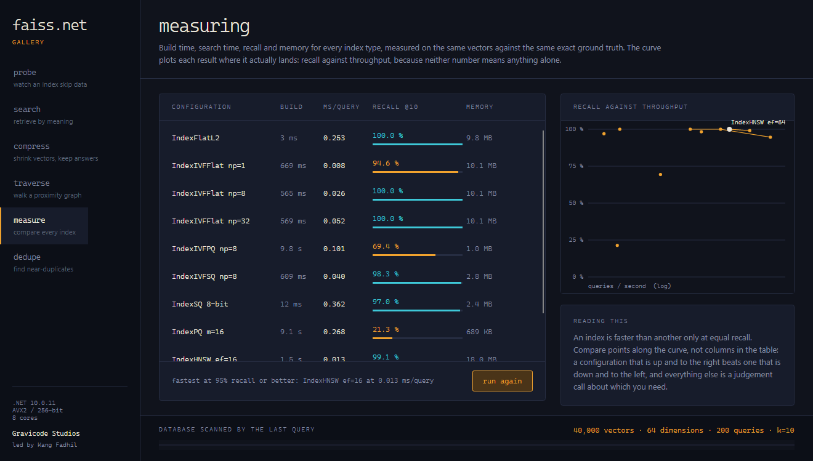

# FAISS.Net

**Pencarian kemiripan berperforma tinggi untuk .NET.** Porting [FAISS](https://github.com/facebookresearch/faiss) ke C# terkelola dari nol — tanpa biner native, tanpa P/Invoke — dengan API yang sengaja dibentuk menyerupai versi Python, sehingga kode FAISS yang sudah ada bisa diterjemahkan baris per baris.

*Read this in [English](README.md).*

```csharp
using Faiss.Net;

var index = new IndexFlatL2(dimension: 128);
index.Add(vectors);
var results = index.Search(query, k: 10);
```

Program yang sama di Python FAISS:

```python
index = faiss.IndexFlatL2(128)
index.add(vectors)
D, I = index.search(query, 10)
```

---

## Kenapa proyek ini ada

FAISS adalah implementasi rujukan untuk pencarian vektor, dan sampai sekarang memakainya dari .NET berarti harus ikut mengirim biner native, mencocokkannya dengan setiap platform target, dan menyalin array melintasi batas managed/native pada setiap pemanggilan. FAISS.Net adalah porting sungguhan: algoritmanya ditulis ulang di atas `Span<T>`, `System.Runtime.Intrinsics`, dan thread pool .NET — jadi sebuah index adalah objek terkelola biasa yang bisa Anda bangun, cari, serialisasi, dan debug seperti objek lain.

Yang Anda dapatkan:

- **Satu assembly, semua platform yang didukung .NET.** Tidak ada dependensi native yang perlu dibangun, dikirim, atau dicocokkan versinya.
- **SIMD di seluruh jalur panas.** Kernel jarak memilih AVX-512, AVX2, SSE, atau NEON saat runtime; tidak ada yang skalar kecuali memang perangkat kerasnya begitu.
- **Pencarian tanpa alokasi.** Memori sementara diambil dari `ArrayPool<T>`; kueri yang sudah panas tidak mengalokasikan apa pun.
- **API bergaya Python.** `Train`, `Add`, `Search`, `RangeSearch`, `Reconstruct`, `RemoveIds`, `index_factory` — semuanya ada, dengan penamaan yang sudah Anda kenal.
- **Dibuat untuk layanan, bukan sekadar notebook.** Pencarian tersaring di dalam pemindaian, parameter pencarian per pemanggilan, pencarian yang tetap berjalan sementara penulis menambah data, dan persistensi inkremental yang aman terhadap crash.

---

## Instalasi

```bash
dotnet add package Gravicode.FaissNet
dotnet add package Gravicode.FaissNet.Gpu   # opsional, CUDA/OpenCL lewat ILGPU
```

Menargetkan **.NET 10**.

---

## Galeri

`FAISS.Net Gallery` adalah aplikasi desktop Avalonia yang membuat setiap kompromi terasa nyata — tiap layar mengukur index sungguhan pada vektor sungguhan dan menunjukkan berapa harga dari pilihan itu.

```bash
dotnet run -c Release --project samples/Faiss.Net.Gallery
```



Pita di bagian bawah adalah seluruh basis data, dibagi menjadi sel-sel milik index. Bagian yang menyala adalah yang benar-benar diperiksa oleh kueri terakhir — 243 vektor dari 40.000, atau 0,6%, untuk 94,6% jawaban yang benar. Geser `nprobe` dan lihat pita itu terisi.



Setiap jenis index diukur pada vektor yang sama terhadap ground truth eksak yang sama, dan setiap konfigurasi diplot tepat di posisinya pada kurva recall terhadap throughput.

[Lihat keenam layarnya →](docs/id/gallery.md)

---

## Isi pustaka

| | |
|---|---|
| **Eksak** | `IndexFlatL2`, `IndexFlatIP`, `IndexFlat` — perkalian matriks berblok untuk batch kueri |
| **Inverted file** | `IndexIVFFlat`, `IndexIVFPQ` (tabel praskomputasi opsional), `IndexIVFScalarQuantizer` |
| **Coarse quantizer** | index apa pun, termasuk `IndexHNSWFlat` (dengan perbaikan sink) dan `MultiIndexQuantizer` (IMI) |
| **Graf** | `IndexHNSWFlat`, `IndexHNSWSQ`, `IndexHNSWPQ`, `IndexNSGFlat` |
| **Flat terkompresi** | `IndexPQ`, `IndexScalarQuantizer` (dekode fp16, 8-bit, dan 4-bit dengan SIMD) |
| **Additive quantizer** | `IndexResidualQuantizer`, `IndexLocalSearchQuantizer`, beserta varian IVF-nya |
| **Pemeringkatan ulang** | `IndexRefine`, `IndexRefineFlat` |
| **Biner** | `IndexBinaryFlat`, `IndexBinaryIVF`, `IndexBinaryHNSW` |
| **Sparse** | `IndexSparseFlat` — inner product eksak di atas inverted index |
| **Penyaringan** | `IDSelector` (range, batch, bitmap, predikat, not/and/or/xor), `SearchParameters*` |
| **Komposisi** | `IndexIDMap`, `IndexIDMap2`, `IndexPreTransform`, `IndexReplicas`, `IndexShards`, `SynchronizedIndex` |
| **Transformasi** | `PCAMatrix`, `OPQMatrix` (persegi atau menurunkan dimensi), `RandomRotationMatrix`, `NormalizationTransform` |
| **Quantizer** | `ProductQuantizer`, `ScalarQuantizer`, `Kmeans` (Lloyd atau mini-batch) |
| **GPU** | `IndexFlatL2Gpu`, `IndexFlatIPGpu`, `GpuIndexIVFFlat`, `GpuIndexIVFPQ`, `StandardGpuResources` |
| **Persistensi** | Format biner berversi, serialisasi ke byte array, `MappedIndexFlat`, `PersistentIndex` (snapshot + journal) |

Metrik: L2 kuadrat, inner product, L1, L-infinity.

---

## Tur lima menit

**Pencarian eksak** — rujukan, dan jawaban yang tepat sampai beberapa ratus ribu vektor.

```csharp
var index = new IndexFlatL2(128);
index.Add(database);                          // datar n × d, row-major
var (distances, labels) = index.Search(queries, k: 10);
```

**Agar sublinear** — partisi ruangnya, lalu periksa sebagiannya saja.

```csharp
var index = new IndexIVFFlat(dimension: 128, nlist: 1024);
index.Train(sample);                          // pelajari centroid setiap sel
index.Add(database);
index.Nprobe = 8;                             // tuas recall/kecepatan, bisa diubah kapan saja
```

**Agar muat** — product quantization, 32× lebih kecil dengan biaya kueri yang sama.

```csharp
var index = new IndexIVFPQ(dimension: 128, nlist: 1024, m: 16);
index.Train(sample);
index.Add(database);
Console.WriteLine($"{index.CompressionRatio:F0}x lebih kecil daripada flat");
```

**Agar cepat** — graf kedekatan, di bawah satu milidetik pada recall tinggi.

```csharp
var index = new IndexHNSWFlat(128, m: 32) { EfConstruction = 80, EfSearch = 64 };
index.Add(database);                          // tanpa tahap pelatihan
```

**Susun resep** — factory memahami string FAISS.

```csharp
var index = FaissNet.IndexFactory(128, "OPQ16,IVF4096,PQ16");
```

**Cosine similarity** — normalisasi, lalu pakai inner product.

```csharp
var index = new IndexPreTransform(new NormalizationTransform(128), new IndexFlatIP(128));
index.Add(embeddings);                        // kueri ikut dinormalisasi secara otomatis
```

**Pencarian tersaring** — k *anggota* terbaik dari sebuah subset, diterapkan di dalam pemindaian.

```csharp
var mine = index.Search(query, k: 10, selector: IDSelector.Range(tenantStart, tenantEnd));
var tuned = ivf.Search(query, k: 10, new SearchParametersIVF { Nprobe = 32, Sel = visible });
```

**Kompres, lalu rebut kembali recall-nya.**

```csharp
var index = FaissNet.IndexFactory(128, "IVF1024,PQ16,RFlat");   // kode 16 byte diperingkat ulang secara eksak
```

**Cari sambil menambah, simpan sambil jalan.**

```csharp
using var index = PersistentIndex.Open("live.index", () => new IndexHNSWFlat(128));
index.Add(batch);          // tercatat di journal, aman terhadap crash; pencarian tetap berjalan
index.Checkpoint();
```

**Id milik Anda sendiri, dan penghapusan.**

```csharp
var index = new IndexIDMap2(new IndexFlatL2(128));
index.AddWithIds(vectors, documentIds);
index.RemoveIds(id => IsDeleted(id));         // id yang tersisa tidak pernah berubah
```

**Simpan, muat, memory-map.**

```csharp
FaissNet.WriteIndex(index, "corpus.index");
var reloaded = FaissNet.ReadIndex("corpus.index");

MappedIndexFlat.Write(flat, "corpus.mmap");
using var mapped = MappedIndexFlat.Open("corpus.mmap");   // dibaca dari disk, tidak dimuat ke memori
```

**GPU**, sebagai pengganti langsung.

```csharp
using var index = new IndexFlatL2Gpu(128);
index.Add(database);
var results = index.Search(queries, 10);      // API sama, hasil sama
```

---

## Memilih index

| Situasi | Gunakan | Alasannya |
|---|---|---|
| Di bawah ~100 ribu vektor | `IndexFlatL2` | Eksak, tanpa pelatihan, tanpa penyetelan. Kerumitan lain tidak sepadan. |
| Perlu lebih cepat | `IndexIVFFlat` | Eksak di dalam sel yang diperiksa. `Nprobe` satu-satunya tuas. |
| Perlu di bawah 1 ms | `IndexHNSWFlat` | Tercepat pada recall tinggi; bayarannya memori dan waktu bangun. |
| Tidak muat di memori | `IndexIVFScalarQuantizer` | 4× lebih kecil, biasanya kehilangan recall di bawah satu poin. |
| Jauh dari muat | `IndexIVFPQ` | 16–64× lebih kecil. Standar untuk skala miliaran. |
| Lebih besar dari RAM | `MappedIndexFlat` | Dicari langsung dari disk, dan dibagi antar proses. |
| Kecepatan graf, memori lebih hemat | `IndexHNSWSQ` | Graf HNSW di atas vektor 8-bit. |
| Terkompresi tapi akurat | `IndexRefineFlat` di atas IVFPQ | Pindai kode, lalu peringkat ulang secara eksak. |
| Kode biner | `IndexBinaryFlat`, `IndexBinaryHNSW` | XOR dan popcount; 32× lebih kecil daripada float32. |
| Vektor sparse | `IndexSparseFlat` | SPLADE atau bag-of-words; hanya menskor posting yang disentuh kueri. |

Panduan lengkap, termasuk cara menentukan `nlist`, `m`, dan `efSearch`: **[Memilih index](docs/id/memilih-index.md)**.

---

## Dokumentasi

| | |
|---|---|
| [Memulai](docs/id/memulai.md) | Instalasi, index pertama, bentuk API-nya |
| [Memilih index](docs/id/memilih-index.md) | Semua jenis index, kapan dipakai, cara menakarnya |
| [Referensi API](docs/id/referensi-api.md) | Tipe, method, dan padanan Python untuk masing-masing |
| [Menjalankan di produksi](docs/id/produksi.md) | Penyaringan, pemeringkatan ulang, pembacaan bersamaan, persistensi inkremental |
| [Arsitektur](docs/id/arsitektur.md) | Cara kerjanya di dalam, dan alasan rancangannya |
| [Performa](docs/id/performa.md) | Apa yang dioptimasi, apa yang diukur, dan apa yang belum |
| [Galeri](docs/id/gallery.md) | Keenam layar demo, dijelaskan satu per satu |

Pelacakan proyek: **[PLAN.md](PLAN.md)** (peta jalan) · **[Progress.md](Progress.md)** (apa yang
sudah selesai, apa yang belum, dan bug yang ditemukan sepanjang jalan). Keduanya berbahasa Inggris.

Tersedia juga dalam **[bahasa Inggris](docs/en/)**.

---

## Struktur repositori

```
src/Faiss.Net              pustakanya
src/Faiss.Net.Gpu          backend ILGPU (CUDA / OpenCL / fallback CPU)
samples/…Samples.Console   tur berpandu, satu bagian per konsep
samples/…Gallery           aplikasi desktop Avalonia
tests/…Tests               86 pengujian: kebenaran, recall, round-trip
benchmarks/                suite yang sepadan dengan Python FAISS, plus BenchmarkDotNet
docs/                      dokumentasi bahasa Inggris dan Indonesia
```

## Membangun

```bash
dotnet build                                    # semuanya
dotnet test                                     # 86 pengujian
dotnet run -c Release --project samples/Faiss.Net.Samples.Console
dotnet run -c Release --project samples/Faiss.Net.Gallery
```

Benchmark — hanya Release, dan sepadan dengan Python FAISS karena kedua sisi membaca vektor yang sama:

```bash
dotnet run -c Release --project benchmarks/Faiss.Net.Benchmarks -- gendata --out data
dotnet run -c Release --project benchmarks/Faiss.Net.Benchmarks -- suite --data data --out results-dotnet.json
python benchmarks/python/bench_faiss.py --data data --out results-python.json
python benchmarks/python/compare.py results-dotnet.json results-python.json
```

Lihat **[benchmarks/README.md](benchmarks/README.md)** untuk cara membaca hasilnya — dan alasan kenapa membandingkan kecepatan pada recall yang berbeda tidak membuktikan apa pun.

---

## Perbedaan dengan FAISS

Disengaja, dan sebaiknya diketahui sebelum Anda memindahkan kode:

- **`FaissNet.X()` alih-alih `faiss.x()`.** Fungsi tingkat modul berada di kelas statis bernama `FaissNet`, karena namespace akar `Faiss.Net` yang diwajibkan sudah memakai nama `Faiss`, dan sebuah namespace menutupi tipe bernama sama di setiap tempat pemanggilan.
- **Format berkasnya milik FAISS.Net sendiri.** Index tidak bisa dipertukarkan antara FAISS.Net dan FAISS. Bangun ulang dari vektor sumber untuk berpindah.
- **`IndexIVFPQ` menyandikan residual untuk L2 dan vektor mentah untuk inner product.** Dekomposisi residual memerlukan suku koreksi tambahan pada inner product; menyandikan langsung lebih sederhana dan eksak terhadap vektor hasil dekode.
- **Index graf tidak mendukung penghapusan**, sama seperti FAISS. Bangun ulang, atau kecualikan id yang dihapus saat pencarian dengan `IDSelector.Not(...)`.
- **`IDSelector.Predicate` adalah tambahan khas C#.** FAISS tidak punya padanan langsungnya; biayanya satu pemanggilan delegate per kandidat.
- **Vektor sparse punya jenis index sendiri**, `IndexSparseFlat`, alih-alih melewati API `Index` yang padat.
- **Tidak ada RaBitQ, PiPNN, fast-scan, maupun Vamana.** Keluarga FAISS upstream terbaru yang berada di luar cakupan porting ini.

---

## Merilis

CI membangun dan menguji di Windows, Linux, dan macOS, serta mengemas kedua pustaka pada setiap
commit. Penerbitan dipicu oleh tag:

```bash
# naikkan <Version> di Directory.Build.props dulu — workflow menolak menerbitkan bila keduanya beda
git tag faissnet-v1.1.0
git push origin faissnet-v1.1.0
```

Tag diberi awalan nama proyek karena proyek ini berada di dalam sebuah monorepo. Berkas workflow-nya
sendiri berada di akar repositori — lihat [.github/workflows/README.md](.github/workflows/README.md).

## Kontribusi

Pengujian harus lulus dan benchmark tidak boleh mundur. Asersi recall berjalan di atas data ber-seed, sehingga kegagalan dapat direproduksi persis, bukan muncul sekali dalam sepuluh kali jalan.

```bash
dotnet build -c Release -warnaserror
dotnet test
dotnet pack -c Release                       # paket muncul di artifacts/packages/
python .github/scripts/check_docs.py .       # tautan valid, kedua bahasa selaras
dotnet run -c Release --project benchmarks/Faiss.Net.Benchmarks -- micro
```

## Lisensi

MIT.

---

Dibuat oleh **Gravicode Studios**, dipimpin oleh **Kang Fadhil**.
